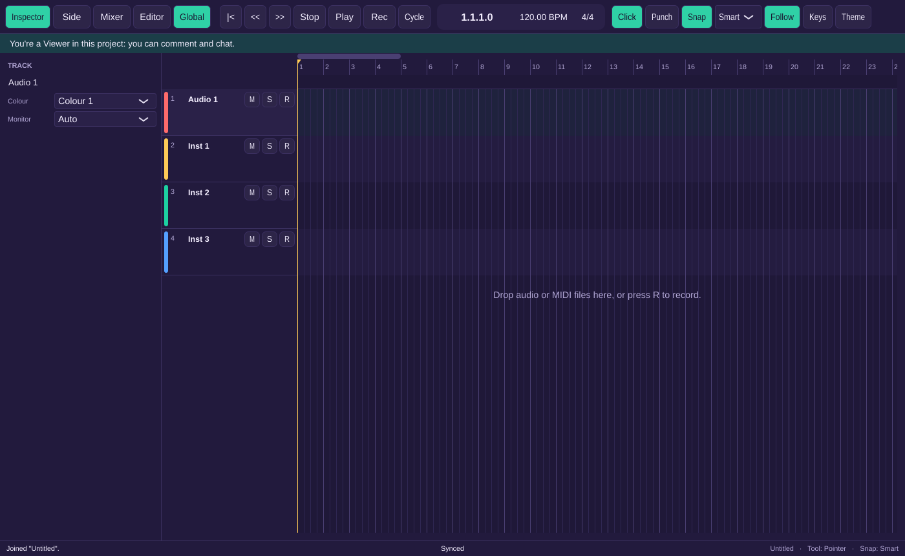
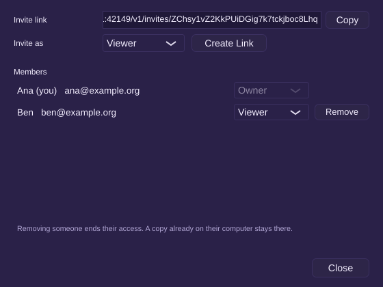
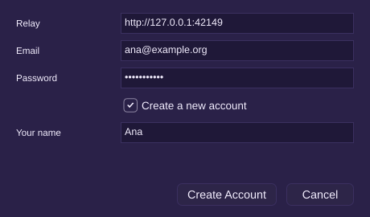

# Milestone 10 report: relay and live sync

## What works

- **The relay** (`weft-relay`, Rust): one binary with a SQLite database.
  - **Accounts:** sign up and sign in with email and password (Argon2id). Access tokens last 15 minutes and refresh tokens 30 days. Five failed sign-ins a minute from one address or for one account get "Too many attempts".
  - **Projects and members:** Owner, Editor and Viewer roles as in 05 §3.2. Invite links carry a role and expire after 7 days. Editors can invite Editors and Viewers; Viewers can't invite. The Owner can change roles and remove members.
  - **Rooms:** one per open project. The relay keeps the change log (written durably before it acknowledges) and a snapshot every 1,000 changes or 10 minutes, and fans changes out to everyone else in the room.
  - **Role enforcement:** the relay refuses changes from a Viewer unless they only touch comments and chat, and tells the client which changes it refused. Removing a member closes their connection at once.
  - **Schema check:** a client too old for the project gets "Update required".
  - Running one: `cargo run --release -p weft-relay -- --addr 127.0.0.1:8080`. It listens on loopback unless started with `--public` and expects a TLS proxy in front of it. Weft only talks to `https://` relays, or `http://` on localhost.
- **Live sync in the app:**
  - Edits reach collaborators as you make them, batched at most every 50 ms. On a 50 ms round trip a region move shows up on the other screen in about 61 ms (68 ms at p95, against a 500 ms target).
  - A fader or region drag is sent once, on release (D-COL-15).
  - Changes from others wait while you're dragging and apply when you let go.
  - **Conflict messages** in the status bar: "Region "Verse" moved by Ben" when your move lost to someone else's, and "Region "Verse" was deleted by Ana" when you edited a region someone deleted.
  - A track deleted while someone recorded onto it gives one Recovered track, the same on every machine.
- **Offline:**
  - Share › Go Offline, or a lost connection. Editing carries on, and the status bar counts what's waiting: "Offline – 12 changes pending".
  - Back online, everything merges. Weft reconnects by itself after 1, 2, 4… up to 30 s.
  - Pending changes survive a crash: the recovery log has the edits and `Cache/sync-pending.txt` remembers which ones the relay hasn't confirmed.
- **The Share menu:**
  - **Sign In… / Sign Out:** the relay's address, then email and password, or "Create a new account" with your name. The account is remembered on this computer, and new edits are credited to it.
  - **Share Project…** uploads a local project to the relay (after saying what it does). Once shared, the same dialog shows the invite link with an Editor/Viewer choice and Copy, and the members with their roles. The Owner can change a role or remove someone there.
  - **Join from Invite Link…** downloads the project into the projects folder and opens it, synced.
  - **Go Offline**, ticked while offline.
- **The status bar** shows the sync state in the middle: Local only, Synced, Syncing…, Offline – N changes pending, Reconnecting…, Update required, Signed out, or Removed from this project. Clicking it shows the relay, the last sync time, pending changes and your role.
- **Read-only banner:** a Viewer sees "You're a Viewer in this project: you can comment and chat." A removed member sees that the project is read-only. Edits are refused with that message, before the relay ever sees them.
- **Solo stays local** and mute is shared (AT-TRK-9). A routing loop made by two people offline ends with one connection switched off, the same on both machines, and no feedback (AT-MIX-10).

 

## Acceptance tests

Every test passes in the Linux container: 238 ctest entries (the [UI] tests are the one `ui-tests` entry), plus `cargo test --workspace`. One entry was skipped because it needs a real audio device. The [S] tests start a real relay on a free localhost port and drive real projects through it.

| Test | Level | Where |
|---|---|---|
| AT-COL-2 three clients × 1,000 random edits with partitions and random delivery; identical documents that pass the invariants | S | `tests/sync/SyncTests.cpp` |
| AT-COL-3 sign up, sign in, wrong password, 6th attempt rate-limited, 15-minute expiry refreshed transparently (sync and REST) | S | `SyncTests.cpp`, `relay/tests/relay.rs` |
| AT-COL-4 share, Editor joins and edits, Viewer comments and chats, relay refuses the Viewer's region change with `forbidden`, removal closes the socket with a read-only banner | S, UI | `SyncTests.cpp`, `relay.rs`, `tests/ui/ShareUiTests.cpp` |
| AT-COL-5 50 ms injected round trip: a region move arrives within 500 ms in 95% of 200 trials | S | `SyncTests.cpp` |
| AT-COL-6 a 2 s fader drag is at most 41 changes and both end on the same value | S | `SyncTests.cpp` |
| AT-COL-7 50 offline edits and 50 online; "Offline – 50 changes pending" then "Synced" | S | `SyncTests.cpp` |
| AT-COL-8 the eight concurrent cases of 05 §4, each a section | S | `SyncTests.cpp` |
| AT-COL-9 un-ACKed changes survive a client crash and are re-sent; a hard-killed relay loses nothing it acknowledged | S | `SyncTests.cpp`, `relay.rs` |
| AT-TRK-9 soloing on one client changes neither the other's document nor its render; mute is shared | S | `SyncTests.cpp` |
| AT-MIX-10 a bus loop made offline by two clients: one disabled edge, the later write by CRDT order, no feedback | S | `SyncTests.cpp` |
| AT-TMP-7 two tempo points at one tick: the greater Id wins and both show the conflict | S | `SyncTests.cpp` |

## Bugs the tests found

The sync tests found four real bugs on the way, all fixed:

- **A fader drag could be split into a change nobody sent.** Asking Automerge for the document's heads in the middle of a gesture quietly commits the gesture so far. Under CPU load an acknowledgement arrived mid-drag, and the next change then depended on one the relay never got. Nothing reads the document during a gesture now (D-ARCH-41).
- **The relay could split a project into two rooms.** A client joining while the last one left could end up in a room the relay had just unloaded, so its changes were stored but never reached the others. Rooms are only unloaded when nobody holds them (D-ARCH-44).
- **Going offline and straight back online** could leave the client thinking it was still joined to the old connection (D-ARCH-42).
- **"Synced" showed too early** for a project shared after it had history: the status now waits until the relay has everything this computer had.

## Stubbed or not yet done

- **Media:** sharing uploads the document only. Audio files, the "N MB of audio" in the share question and downloads for joiners come with media sync in M11 (D-COL-16). A joiner sees regions whose audio is missing until then.
- **Presence** (avatars, pointers, selections) is M11; the relay already relays presence messages. Comments and chat get their panels in M12; the document and the relay's Viewer rule already support them.
- **Invites are links** to copy and send (D-COL-14); there's no email invite. The Owner can't delete a project from the relay in the UI yet (the relay supports it).
- Share dialog calls to the relay block the window for a moment (at most their timeout) until they move to a background thread in M11 (D-COL-20).
- "Version History" in the Share menu is M12.

## Known issues

- **Needs your call:** where the public relay will be hosted. Until then you run your own; the app has no built-in relay address.
- The account's tokens are kept in a file in the settings folder, not in the Windows credential store.
- The relay's HTTPS story is a reverse proxy (D-ARCH-38). It has been tested over plain HTTP on localhost only; the client's TLS path is compiled and its certificate roots are bundled, but no test talks to a real `https://` relay yet.
- The Windows CI build compiles and runs the [S] tests against the relay too. Real-network behavior (Wi-Fi drops, sleep and wake) still needs hands-on checks.
