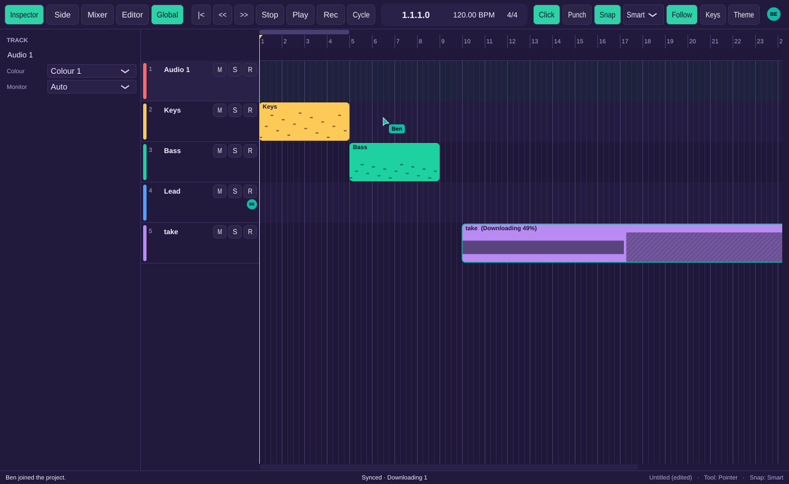

# Milestone 11 report: presence and audio file sync

Ana's window while Ben works in the same project: his avatar at the top right, his pointer
over Keys at bar 6, his badge on Lead (the track he's on), his selection outlined in his
colour, and his 30-second take arriving, half of it here and playable.

## What works

- **Audio files travel with the project.**
  - Recording or importing in a shared project uploads the audio in the background. Collaborators see the new region at once, before the upload is done (05 §8.2 step 5).
  - Their copy downloads, regions near anyone's playhead first, is checked against its BLAKE3 hash and goes into the project's `Media/` folder. Large plug-in states (over 64 KB) travel the same way.
  - **Resumable:** uploads go in 8 MB chunks and carry on from the last complete chunk after an interruption. Downloads go in 1 MB ranges to a `.part` file and carry on from what's on disk.
  - **Verified:** the relay checks the hash before it makes a file available. A download that doesn't match is thrown away and tried once more, then reported in the status bar.
  - **Private:** only members of a project can fetch its files (403 otherwise, even with a valid sign-in). The same file used in another project of the same Owner isn't uploaded again.
  - At most 2 uploads and 2 downloads run at once. Uploads pause while you record.
- **Playing what has arrived.** A file that is still downloading plays the part that's here; the rest of the region is silent, without counting as a disk problem. The region shows "Downloading 49%" with the missing part hatched, or "Waiting for upload" while its author is still sending it. Bounce warns "N regions have media not yet downloaded" with Bounce Anyway (D-W9-1).
- **The status bar** adds what's moving to the sync state: "Synced · Uploading 1 · Downloading 2".
- **Sharing** says how much audio goes up: "This uploads the project and its 12.4 MB of audio to …".
- **Presence:**
  - **Avatars** in the control bar: initials in each collaborator's colour, up to 5 then "+N". Idle (2 minutes without input) dims them and recording turns them red. Hovering shows the name, what they're doing and the track and editor they're in; clicking scrolls to what they selected, or their playhead.
  - **Pointers** over the arrange view and the piano roll, with a name label, at the same bar and track (or note) whatever your zoom. They fade out 5 s after they stop moving.
  - **Playheads** of collaborators who are playing, moved on smoothly between updates through the tempo map.
  - **Selections** outlined in the collaborator's colour (stacked when two people select the same region), and their notes in the piano roll.
  - **Track badges** on the header of the track each collaborator is working on, red while they record on it.
  - Rates as in 05 §5: pointers at most 20 times a second, playheads on start and stop and every 2 s, everything else 100 ms after it settles. A second computer of the same person shows as a second presence.
- **Missing plug-ins from collaborators** (F-COL-20): when someone adds a plug-in you don't have, its slot passes audio through and keeps their settings untouched, and you get "Missing Plug-ins: Phantom EQ, added by Ana". Moving the track's fader on your side leaves their plug-in state byte-for-byte as it was.

## Acceptance tests

Every test passes in the Linux container: 248 ctest entries (the [UI] tests are the one `ui-tests` entry), plus `cargo test --workspace`. One entry was skipped because it needs a real audio device. The [S] tests run real projects through a relay on localhost.

| Test | Level | Where |
|---|---|---|
| AT-COL-10 B appears on A within 1 s of connecting (a second computer of B's too), idle after 2 minutes, active again on input; gone when B leaves; everyone cleared after 45 s offline | S, UI | `tests/sync/PresenceTests.cpp`, `tests/ui/CollabUiTests.cpp` |
| AT-COL-11 B's pointer at bar 9 on track 2 lands there on A at a different zoom; at most 41 updates for 2 s of movement; B's playhead extrapolated within 50 ms (with B's clock 30 ms off); the fade | S, UI | `PresenceTests.cpp`, `CollabUiTests.cpp` |
| AT-COL-12 B's two selected regions outlined on A in B's colour; B's badge on track 3; the red badge while B records; 700 selected notes send 500 ids and the count | S, UI | `PresenceTests.cpp`, `CollabUiTests.cpp` |
| AT-COL-13 the same WAV stored on two clients gets the same `b3:` hash; BLAKE3 reference vectors and the MP3 fixture's hash from an independent implementation | U | `tests/unit/MediaImportTests.cpp` |
| AT-COL-14 the region reaches B before its audio; B shows it waiting, silent and without underruns; after the upload B downloads, verifies and plays it; the Owner's second project gets a HEAD hit and sends nothing | S | `tests/sync/MediaTests.cpp` |
| AT-COL-15 an upload stopped before its second chunk resumes from 8 MB; a corrupted download is fetched twice, then reported, and leaves no file; one corrupted once succeeds on the retry | S | `MediaTests.cpp`, `relay/tests/relay.rs` |
| AT-COL-16 a signed-in non-member gets 403 for GET, HEAD and upload; the transfer gives up | S | `MediaTests.cpp`, `relay.rs` |
| AT-COL-17 half a download plays its first part and is silent after, without underruns; progress and "Downloading 1"; uploads wait while recording; the region's hatch and the status bar in the window; the share question's audio size | S, E, UI | `MediaTests.cpp`, `CollabUiTests.cpp` |
| AT-COL-18 a partly downloaded file counts as not yet downloaded for the bounce warning | E | `tests/engine/BounceTests.cpp` |
| AT-COL-31 B, without A's plug-in, hears passthrough through a placeholder, gets the notice naming the plug-in and Ana, and B's fader moves leave the plug-in state byte-identical | S, UI | `tests/sync/SyncTests.cpp`, `CollabUiTests.cpp` |

## Stubbed or not yet done

- **Follow mode** (follow a collaborator's view) is v2, as the spec has it; clicking an avatar scrolls there once.
- Header badges follow the track a collaborator has selected or is recording on, not "their last edit within 10 s" (D-COL-31).
- The Share dialog's own calls to the relay still block the window briefly (D-COL-20); audio transfers are on background threads.
- Downloaded files are kept per project; two projects on one computer that use the same file each download it (D-COL-29).

## Known issues

- **Needs your call (unchanged):** where the public relay will be hosted, the donation link, and the ASIO SDK for release builds.
- Waveform overviews of a file that's still downloading are recomputed as each part arrives; for very long files this is more work than it needs to be.
- Transfers have been tested on localhost only. Behaviour on a slow or flaky connection (resume after Wi-Fi drops, a laptop going to sleep mid-upload) still needs hands-on checks.
