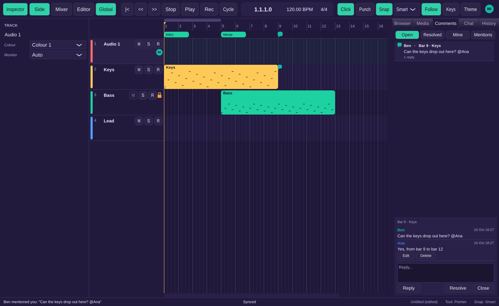
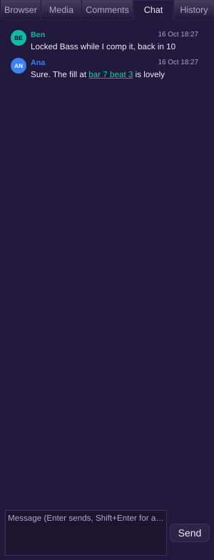
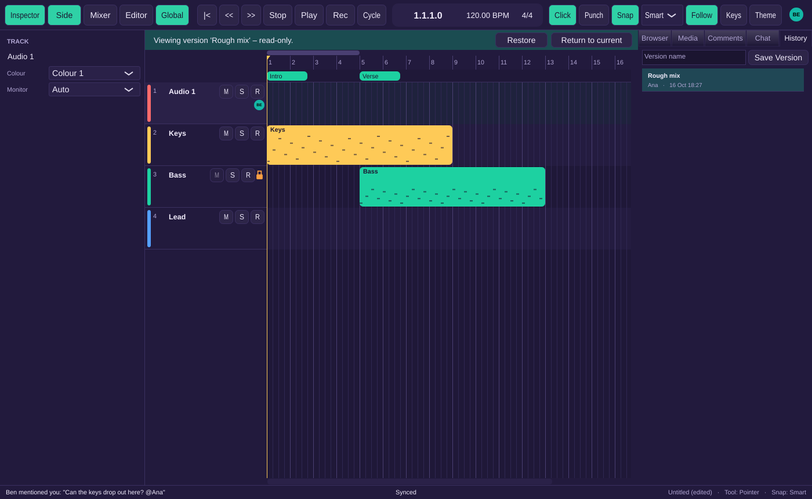

# Milestone 12 report: comments, chat, track locks and version history

Ana's window in a shared project: Ben's comment pinned at bar 9 on Keys (in the marker lane
and on the track), the thread open in the Comments tab with Ana's reply, and the padlock on
Bass, which Ben has locked while he comps it. The status bar shows Ben's mention of Ana.

## What works

- **Track locks** (F-COL-11, F-TRK-16, 05 §7).
  - Lock or unlock from a track header's right-click menu, the padlock on the header, or Track > Lock/Unlock Track. Locking is off until someone uses it, and nothing prompts while two people edit the same track.
  - On everyone else's screen, a track you've locked shows a padlock. Its name, mute, input and other controls are disabled, and so is its channel strip (fader, pan, mute, input, inserts and sends). Hovering shows "Locked by Ana". Solo and record-arm stay available because they are per-person.
  - Its regions can't be picked up, dragged onto or off it, or edited from the keyboard. Its automation and takes are refused too, and the status bar says "Locked by Ana." The checks run in the document layer, so every editor and command honours them, not just the ones the UI greys out.
  - The project Owner can break any lock after confirming "Ben has locked "Bass". Break the lock? They'll be told." The holder gets a "Lock Broken" alert.
  - A lock expires 24 hours after its holder was last seen in the project. Edits someone made offline before they saw a lock still merge, and the lock holder is told: "Ben's offline edits to "Bass" were merged."
- **Comments** (F-COL-12).
  - Shift+C (or Edit > Add Comment, or right-click > Add Comment on a lane) opens a box in the Comments tab at the playhead and the selected track ("New comment at Bar 9 · Keys").
  - Pins appear in the marker lane and on the track's lane; clicking a pin opens its thread. Threads support replies, Resolve and Reopen, and Edit and Delete on your own comments only.
  - The filters are Open, Resolved, Mine and Mentions; clicking the active filter again shows every thread.
  - `@Ben` mentions notify Ben in the status bar the next time he connects, and the Comments tab shows a dot until he looks at it.
  - Deleting a comment's track leaves the comment at its bar in the marker lane.
- **Markers** (F-COL-13): already shared since M10. Concurrent renames converge, and this is now tested.
- **Chat** (F-COL-14).
  - The Chat tab: Enter sends, Shift+Enter adds a new line, and the tab reads "Chat (2)" while there are unread messages.
  - `bar 17`, `bar 7 beat 3` and `0:30` in a message are links that move your playhead there.
  - Messages appear in the same order for everyone, including messages sent offline. Messages over 4,000 characters are refused, and the text stays in the box so it can be shortened.
- **Version history** (F-COL-15).
  - File > Save Version... (Ctrl+Alt+S) names a version in the History tab. Named versions are listed newest first; automatic ones are grouped by day.
  - Clicking a version previews it read-only under a banner, "Viewing version 'Mix 1' – read-only.", with Restore and Return to current. Comments, chat and the version list stay live while you preview.
  - Restore is a new change that makes the project's content match the version on everyone's computer, adds "Restored 'Mix 1'", and can be undone.
  - An automatic version ("Ana's session") is made when someone who changed the project closes it or is idle for 30 minutes.
- Locks, comments, chat and saved versions are kept in the project document, so they are saved, sync and work offline like everything else. None of them is an undo step.

 

## Acceptance tests

Every test passes in the Linux container: 263 ctest entries (the [UI] tests are the one `ui-tests` entry), plus `cargo test --workspace`, `cargo fmt` and `cargo clippy`. One entry was skipped because it needs a real audio device. The [S] tests run real projects through a relay on localhost.

| Test | Level | Where |
|---|---|---|
| AT-COL-19 locking is off by default; two clients edit one track with no prompts | S | `tests/sync/CollabTests.cpp` |
| AT-COL-20 (and AT-TRK-12) B's edits to A's locked track are refused: fields, mute, strip, regions, dragging onto it, automation, takes; solo stays local. In the window: disabled header and strip controls with "Locked by Ana", refused region clicks and drags | S, UI | `CollabTests.cpp`, `tests/ui/CollabPanelTests.cpp` |
| AT-COL-21 B's offline edits made before seeing the lock merge on reconnect, and A is told | S | `CollabTests.cpp` |
| AT-COL-22 the Owner breaks a lock after confirming and the holder is told (also in the window); a lock expires 24 h after its holder was last seen (mocked clock) | S, UI | `CollabTests.cpp`, `CollabPanelTests.cpp` |
| AT-COL-23 lock state survives save and load and syncs as a document field | U | `tests/unit/CollabModelTests.cpp` |
| AT-COL-24 a comment at bar 9 on track 2: B sees the pin and thread, replies; A resolves; the four filters; the pin outlives track 2. In the window: Shift+C, the box, pins, the thread, the filters | S, UI | `CollabTests.cpp`, `CollabPanelTests.cpp` |
| AT-COL-25 a mention notifies B on next connect; only the author can edit | S, UI | `CollabTests.cpp`, `CollabPanelTests.cpp` |
| AT-COL-26 markers created, renamed, moved and deleted on A appear on B; concurrent renames converge | S | `CollabTests.cpp` |
| AT-COL-27 one order on every client; offline messages after reconnect; "bar 17" moves the reader's playhead; over 4,000 characters refused. In the window: Enter and Shift+Enter, the unread count, clicking the link | S, UI | `CollabTests.cpp`, `CollabPanelTests.cpp` |
| AT-COL-28 Save Version "Mix 1", more edits, preview read-only, Restore makes every client's content equal "Mix 1", adds "Restored 'Mix 1'", and undo goes back. In the window: the History tab, banner, refused edits, Return to current, Restore | S, UI | `CollabTests.cpp`, `CollabPanelTests.cpp` |
| AT-COL-29 an automatic version when a user with changes closes the project, none without changes | S, UI | `CollabTests.cpp`, `CollabPanelTests.cpp` |
| AT-COL-30 per-user undo through the relay: only what is still mine is undone | S | `CollabTests.cpp` |

## Decisions made (05 §9.4)

- D-COL-35: locks, comments, chat and saving a version aren't undo steps, but restoring is.
- D-COL-36: restoring a version leaves comments, chat, versions and the current locks as they are.
- D-COL-37: previewing is read-only, but comments, chat and the History list stay live.
- D-COL-38: lock expiry counts from when this computer last saw the holder, or else from when the lock was taken. Once a lock expires, anyone can edit the track or take the lock.
- D-COL-39: the "lock broken" and "offline edits merged" notices are raised on the holder's computer.
- D-COL-40: automatic versions are made on close or after 30 minutes idle, only after edits. Choosing Don't Save makes none.
- D-COL-41: only Owners and Editors save versions. A project that was never shared has its user as the Owner.
- D-COL-42: the comment filters work as described above.
- D-COL-43: Shift+C and Save Version open a box in the side panel rather than a dialog. A version saved without a name is "Untitled version".
- D-COL-44: mentions are stored by user id and shown by name.

## Fixed along the way

- **Audio sync could send a file twice.** A file that had just finished uploading could be sent again, and a file someone had just downloaded could be uploaded straight back. This happened when the app checked for work between the transfer finishing and the app taking note of it. The relay noticed it already had the file, so nothing was stored twice, but the status bar briefly showed "Uploading 1". It only showed up on the Windows CI runner. A transfer now counts as busy until the app has taken note of it, and downloaded files are never sent back.

## Stubbed or not yet done

- The relay's own once-a-day automatic versions (05 §9.3) aren't built yet. Only the client's end-of-session versions exist.
- Locks are enforced by each client, not by the relay, as the spec has it for MVP (D-COL-8).
- Clicking a pin opens its thread in a popover on Windows. Headless tests and Linux show the thread in the Comments tab instead.

## Known issues

- **Needs your call (unchanged):** where the public relay will be hosted, the donation link, and the ASIO SDK for release builds.
- Lock expiry relies on each computer's own record of when it last saw the holder. Two computers can disagree for a while about whether a lock has expired. The difference is at most the time one of them was offline.
- A long chat history is laid out in full each time a message arrives. That's fine for hundreds of messages but would need a smarter list for many thousands.
- Next is M13: hardening, performance, the Windows hardware test pass and the installer.
