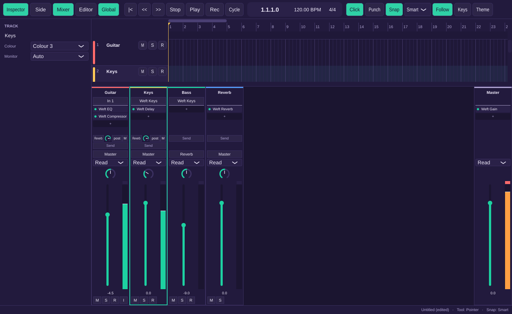

# Milestone 6 report: the mixer and plug-ins

## What works

- **Mixer** in the editors area (X, or Mix > Mixer). It shows one strip per track in track order, then the buses, then Master pinned at the right edge. Selecting a strip selects its track. Each strip has:
  - the name, in the track's colour (double-click to rename);
  - the hardware input (audio tracks) or the instrument slot (instrument tracks: Weft Keys by default, or any instrument from the menu);
  - insert slots: the filled ones plus a free one, up to 15. The left edge toggles bypass, the name opens the editor, dragging reorders, and right-click offers Open, Bypass, Remove and Replace;
  - send slots, up to 8: the target bus, a level knob, Pre/Post and mute. The free slot's menu lists the buses and New Bus;
  - the output menu (Master, buses, New Bus), the automation mode, and pan (balance on stereo tracks);
  - a fader from −inf to +6 dB with a typed readout, a post-fader meter with 2 s peak hold and a clip light that stays lit until clicked;
  - Mute, Solo (Ctrl+click: solo only this one), Record and Monitor (Auto/On/Off).

  Alt+click resets the fader, pan and send knobs, and Shift-drag adjusts finely. Menu items that would close a feedback loop are disabled and say why. An output or send that the cycle breaker turned off is shown in the warning colour with "Disabled: feedback loop".
- **Buses.** New Bus from a send or an output creates "Bus N" at 0 dB going to Master, with a 0 dB send (or the output) to it, as one undo step. Deleting a bus with sends asks "Remove Bus 1 and N sends?", removes those sends and reroutes channels that output to it to Master. A channel sends to a bus only once.
- **Mixer engine.**
  - Inserts run in slot order, and bypassed ones are skipped bit-exactly. Mono channels run their inserts in stereo and average back.
  - Pre-fader and post-fader sends work. Fader and pan changes ramp over one block. Mute and solo-safe routing work as before.
  - Master inserts process the whole mix.
- **Delay compensation.** Every path to the master, sends included, is delayed to match the slowest. Changes crossfade over 10 ms while playing. Offline renders drop the compensation delay so they stay on the timeline.
- **Built-in effects:** Weft EQ (HPF/LPF, low and high shelves, two peaks), Weft Compressor, Weft Delay, Weft Reverb and Weft Gain. Weft Keys gains four presets (Soft Keys, Glass Bell, Reed Organ, Warm Pad) and a level control. None of them adds latency, and none allocates, locks or produces denormals on the audio thread.
- **VST3 hosting.**
  - Plug-ins are scanned out of process by `weft-plugin-scanner`, which ships next to the app. A plug-in that crashes or hangs the scanner is marked Failed and the app keeps running. The list is kept in the user's settings folder.
  - Hosted plug-ins work as inserts and as instruments, report their latency for compensation, and save their state chunk. State over 64 KB goes to `Blobs/` in the project.
  - A plug-in that isn't installed becomes a placeholder. It passes audio, shows "Not installed on this computer" and keeps its saved state untouched.
- **Plug-in windows.** One floating window per instance, kept on top, which remembers its position while the app runs. It shows the plug-in's own editor, or a slider per parameter when it has none (built-ins included for now).
  - Parameter changes go into the project as you move them, one undo step per gesture.
  - The state chunk is written when the window closes or after 2 s without changes.
- **Plug-in manager** (Mix > Plug-in Manager) lists each plug-in's name, vendor, format and status. Each one can be enabled or disabled. Rescan picks up new or changed files, and Retry Failed scans failed ones again.
- **Menus.** There's a new Mix menu (New Bus, Mixer, Plug-in Manager), and Track gains Delete Track.

## Acceptance tests

Every [U], [E] and [UI] test passes in the Linux container: 189 ctest entries, with the [UI] tests in the one `ui-tests` entry. One entry was skipped because it needs a real audio device.

| Test | Level | Where |
|---|---|---|
| AT-MIX-1 strip order, buses, Master pinned, selection | UI | `tests/ui/MixerUiTests.cpp` |
| AT-MIX-2 −6.02 dB halves, −inf, +6 dB max, ramp with no step; Alt+click, typed levels | E, UI | `tests/engine/MixerEngineTests.cpp`, `MixerUiTests.cpp` |
| AT-MIX-3 −3 dB pan law, hard left/right, stereo balance | E | `MixerEngineTests.cpp` |
| AT-MIX-4 meter peak −6.0, clip latches until clicked, 2 s hold | E, UI | both |
| AT-MIX-5 insert order, bit-exact bypass, 15 slots; TestGain then EQ | E | `MixerEngineTests.cpp`, `tests/plugins/PluginHostTests.cpp` |
| AT-MIX-6 instrument slot: Weft Keys, replace keeps regions and inserts; TestSynth | E | both |
| AT-MIX-7 post and pre sends, send limits | E | `MixerEngineTests.cpp` |
| AT-MIX-8 New Bus from a send; removing it asks, removes sends, reroutes | U, UI | `tests/unit/UndoTests.cpp`, `MixerUiTests.cpp` |
| AT-MIX-9 A → Bus 1 → Bus 2 allowed; looping output and send refused and disabled | U, UI | `UndoTests.cpp`, `MixerUiTests.cpp` |
| AT-MIX-11 master sum, master fader, master insert | E | `MixerEngineTests.cpp` |
| AT-MIX-12 TestLatency impulses aligned, also after removal and through a send | E | `MixerEngineTests.cpp`, `PluginHostTests.cpp` |
| AT-MIX-13 compensation changes crossfade with no jump | E | `MixerEngineTests.cpp` |
| AT-PLG-2 TestGain and TestSynth through the VST3 host | E | `PluginHostTests.cpp` |
| AT-PLG-3 scan lists working plug-ins, crash marked Failed, skip and retry | E | `PluginHostTests.cpp` |
| AT-PLG-4 manager columns, disable removes from menus, Rescan finds a new one | UI | `MixerUiTests.cpp` |
| AT-PLG-5 generic sliders change the parameter (TestGain), one undo step | UI | `MixerUiTests.cpp` |
| AT-PLG-6 +3.5 dB survives save and reload; state over 64 KB as a blob | E | `PluginHostTests.cpp`, `MixerEngineTests.cpp` |
| AT-PLG-7 Weft Keys presets, 16 voices, 8 loud notes under 0 dBFS | E | `MixerEngineTests.cpp` |
| AT-PLG-8 EQ, compressor, delay, reverb and gain measurements | E | `MixerEngineTests.cpp` |
| AT-PLG-9 built-ins: no latency, finite and fast after 60 s of silence | E | `MixerEngineTests.cpp` |
| AT-PLG-11 missing plug-in: placeholder passes audio, keeps state | E, UI | `MixerEngineTests.cpp`, `MixerUiTests.cpp` |
| AT-RT-1 (extended) mixer edits during playback allocate nothing | E | `tests/engine/TransportEngineTests.cpp` |
| AT-PRL-9, AT-PRL-13 now also against TestSynth, as M5 promised | E | `PluginHostTests.cpp` |

Not run here, as planned:

- **AT-PLG-1** is [HW]. It needs real third-party VST3s and Windows, and the list of plug-ins is still to be fixed (Phase 2). The code path is the one the fixture tests use.
- **AT-MIX-10** is [S] and needs collaboration (M10–M11). The cycle breaker and the disabled-edge display it depends on are in place and tested.
- **AT-PLG-10** is automation, which is M7.

## Stubbed or not yet in the mixer

- Ctrl+drag to copy an insert to another channel isn't done. Dragging only reorders within a channel.
- The Inspector's two compact channel strips aren't there yet. The mixer is the only place for these controls.
- Built-in effects use the generic slider editor. They don't have their own editors yet.
- Rescan runs on the message thread, so the window doesn't respond while it scans (each plug-in has a 60 s limit).
- Lock icons and collaborator badges on strips wait for collaboration.

## Known issues

- Windows UI tests and VST3 loading on Windows run only on the Windows CI runner. Nothing was clicked through by hand on Windows.
- AT-TRN-17 (the CPU meter) failed once when ctest ran with 8 parallel jobs and passed when rerun alone. It's timing-sensitive under heavy load. CI runs it fine so far.
- The automation mode selector stores the mode, but nothing reads it until M7.

## Decisions made in this milestone

D-W6-4 to D-W6-8 and D-W7-3 (`docs/spec/02-workflows.md`), D-DM-20 and D-DM-21 (`docs/spec/03-data-model.md`), D-UI-10 and D-UI-11 (`docs/spec/04-ui-spec.md`), D-ARCH-25 to D-ARCH-27 (`docs/ARCHITECTURE.md`).
