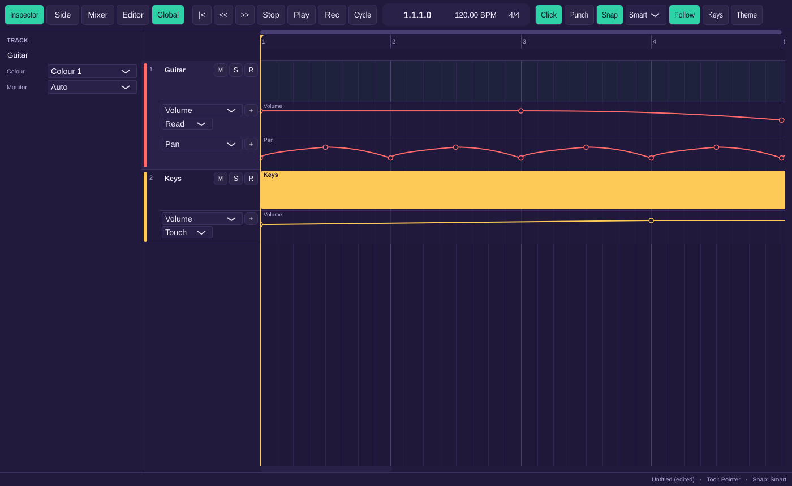

# Milestone 7 report: automation

## What works

- **Automation view** (A, or View > Automation). Each track gets lanes below it, Volume first. Each lane has a parameter selector and a "+" that adds a lane for the next parameter. The first lane also has the track's mode selector (Off, Read, Touch, Latch, Write; Read by default).
- **What can be automated:** volume, pan, mute, each send's level, and every parameter of the instrument and each insert. Buses and the master offer the same. The master's pan now works as balance.
- **Drawing and editing points:**
  - Click a lane to add a point at the snapped time and the clicked value.
  - Drag to move the selected points. Shift keeps the drag to one axis.
  - Shift+click adds or removes a point from the selection. Dragging from an empty spot rubber-bands.
  - Alt+drag on a segment bends it.
  - Delete removes the selected points.
  - Each edit is one undo step.
  - An empty lane shows the static value as a thin line.
- **Playback:**
  - The value holds before the first point and after the last. Segments are linear, or bent with one curve parameter.
  - Volume, pan and send levels move smoothly with no zipper noise. Mute switches at its points.
  - Plug-in parameters change on the exact sample of a lane point, both for built-ins and for hosted VST3 plug-ins. Between points they follow the lane once per block.
  - The offline render (and so the coming bounce) plays automation, master included.
- **Modes and live writing from the mixer:**
  - **Off:** automation is ignored and the controls set static values.
  - **Read:** the controls follow the lane. Moving one overrides the lane while held, snaps back on release, and writes nothing.
  - **Touch:** writes while you hold the control, then glides back to the lane over 200 ms.
  - **Latch:** writes from the first touch until you stop, holding the value you let go at.
  - **Write:** writes every lane of the track from play start, plus anything you touch, until you stop. The track then switches to Latch.

  A pass becomes one undo step, "Write Automation", when the transport stops. Written automation is thinned: a point is kept only when the value has moved more than 0.1 % and at least 50 ms have passed. The mixer's fader, pan and mute buttons move with the automation while it plays.
- **Fader taper.** Lanes and the mixer fader share one fixed taper: +6 dB at the top, 0 dB at 79 % of the travel, and −12 dB halfway.

## Acceptance tests

Every [U], [E] and [UI] test passes in the Linux container. That's 205 ctest entries, with the [UI] tests in the one `ui-tests` entry. One entry was skipped because it needs a real audio device.

| Test | Level | Where |
|---|---|---|
| AT-AUT-1 A toggles automation view; Volume and Read by default; "+" adds a lane | UI | `tests/ui/AutomationUiTests.cpp` |
| AT-AUT-2 Volume, Pan, Mute, sends and every plug-in parameter, on tracks, buses and master | U, UI | `tests/unit/AutomationTests.cpp`, `AutomationUiTests.cpp` |
| AT-AUT-3 click adds a snapped point, drag, Shift-drag, rubber band + Delete, bend | U, UI | `AutomationTests.cpp`, `AutomationUiTests.cpp` |
| AT-AUT-4 hold before and after, linear midpoint, curve +0.5 differs and stays monotonic | E | `tests/engine/AutomationEngineTests.cpp` |
| AT-AUT-5 pan moves a sine from L to R, mute silences, send level changes the bus input | E | `AutomationEngineTests.cpp` |
| AT-AUT-6 a Weft Gain step lands on its sample (96,125, inside a block) | E | `AutomationEngineTests.cpp` |
| AT-AUT-7 Off uses the static value; Read follows and a touch snaps back unwritten | E | `AutomationEngineTests.cpp` |
| AT-AUT-8 Touch writes only bar 2 to 3 and glides back within 200 ms | E | `AutomationEngineTests.cpp` |
| AT-AUT-9 Latch writes bar 2 to 5, holding the release value | E | `AutomationEngineTests.cpp` |
| AT-AUT-10 Write replaces bars 1 to 4, switches to Latch, one undo step | E | `AutomationEngineTests.cpp` |
| AT-AUT-11 a constant gives 2 points, a ramp at most one per 50 ms | U | `AutomationTests.cpp` |
| AT-AUT-12 master volume automation in the render; bus pan automation | E | `AutomationEngineTests.cpp` |
| AT-PLG-10 a lane on TestGain's gain, through the VST3 host, changes on its sample | E | `tests/plugins/PluginHostTests.cpp` |
| AT-RT-1 (extended) automated playback, insert splits and touches allocate nothing | E | `AutomationEngineTests.cpp` |

There's also a UI test showing that in Touch the mixer fader follows the lane, and that a fader gesture during playback writes automation without changing the static volume.

## Stubbed or not yet done

- The track header's small fader and pan, the Inspector's channel strips and plug-in windows don't write automation yet. Live writing comes from the mixer's fader, pan and mute. Send knobs and plug-in sliders change static values only.
- Lanes always sit below the track. The overlay option of W-8 step 2 isn't there.
- Instrument parameters follow automation once per block. Only insert parameters are split on exact samples.
- The status line doesn't yet say "writing automation on <track>". `LiveAutomation::writingTracks()` reports it, ready for presence in M11.
- Snapping when adding points follows the arrange snap setting. There's no separate automation grid.

## Known issues

- Windows UI tests and VST3 loading on Windows run only on the Windows CI runner. Nothing was clicked through by hand.
- Live writing samples the controls from the UI timer (about every 33 ms) and from every control move. A pass can't be more detailed than that, and the 50 ms thinning is coarser anyway (D-ARCH-30).
- If the cycle jumps back during a pass, writing for each control stops at the jump. The rest of the pass still plays (D-W8-4).

## Decisions made in this milestone

D-W8-4 and D-W8-5 (`docs/spec/02-workflows.md`), D-DM-22 (`docs/spec/03-data-model.md`), D-UI-12 (`docs/spec/04-ui-spec.md`), D-ARCH-28 to D-ARCH-30 (`docs/ARCHITECTURE.md`).
