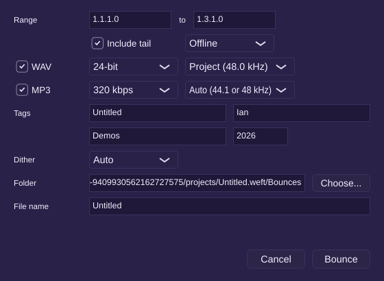

# Milestone 8 report: bounce and export

## What works

- **File > Bounce (Ctrl+B)** opens the Bounce dialog with the W-9 defaults:
  - **Range:** the cycle range when cycle is on. Otherwise from the start to the end marker, or to the end of the last region when there's no marker.
  - Include tail on, Offline mode, and a 24-bit WAV at the project rate.
  - The file goes to `<project folder>/Bounces/<project name>.wav`.
- **Offline bounce** renders through a private engine as fast as the computer allows, with a progress bar and Cancel. A 3-minute project with four built-in effects bounces in about 10 s in the Linux Debug build, and two runs give byte-identical files.
- **Real-time bounce** plays the range on the live engine, so you hear it, and captures the master output. If the audio device runs at another rate, the capture is converted to the file's rate afterwards. A plug-in that says it can't render offline (the VST3 "OnlyRT" category) switches the bounce to real time, and the status line names that plug-in.
- **WAV** at 16, 24 or 32-bit float, at the project rate or 44.1, 48 or 96 kHz. Sample-rate conversion happens before dither.
- **MP3** through LAME:
  - 320, 256, 192 or 128 kbps CBR, or VBR quality 0 to 9.
  - 44.1 or 48 kHz. Auto follows the project when it runs at one of those, otherwise 44.1.
  - ID3 Title, Artist, Album and Year tags. Title defaults to the project name and Artist to your computer user name.
  - The file carries the LAME/Info header, so players trim the encoder delay and the length comes out exact.
- **Dither:** Auto, Off or On. Auto adds TPDF dither below 24 bits, with a fixed seed so bounces repeat exactly.
- **Tail:** with Include tail on, the bounce keeps rendering after the range end until the output stays below −90 dBFS for 200 ms, up to 10 s.
- **Clipping:** a mix that goes over 0 dBFS says so, for example "Bounce clipped (peak +2.0 dBFS)". Float WAVs keep the overs; 16 and 24-bit files clip.
- **Existing files:** bouncing to a name that's taken asks Replace / Keep Both / Cancel. Keep Both writes "name (2).wav".
- **When it's done:** the dialog shows what was written, with Show in Folder and Add to Project. Add to Project imports the bounce at the range start as a new muted audio track.
- **Missing media (D-W9-1):** when regions have media that isn't there yet, the dialog says how many, and the button reads "Bounce Anyway".

## Acceptance tests

Every [U], [E] and [UI] test passes in the Linux container: 219 ctest entries, with the [UI] tests in the one `ui-tests` entry. One entry was skipped because it needs a real audio device. The Rust crates pass `cargo test`, `fmt` and `clippy`.

| Test | Level | Where |
|---|---|---|
| AT-EXP-1 4 bars to 24-bit WAV is 384,000 samples, equal to a real-time capture within 1 LSB | E | `tests/engine/BounceTests.cpp` |
| AT-EXP-2 16/24/32-float at 44.1/48/96 kHz read back by JUCE's WAV reader; 44.1 kHz length within 1 sample | E | `tests/engine/JuceBounceTests.cpp` |
| AT-EXP-3 320 kbps MP3 of a 10 s sine: 10 s within a frame, peak at the sine, tags match | E | `BounceTests.cpp` |
| AT-EXP-4 VBR quality 2 has a Xing/LAME header and decodes | E | `BounceTests.cpp` |
| AT-EXP-5 3-minute project with built-ins: faster than real time, bit-identical twice | E | `BounceTests.cpp` |
| AT-EXP-6 a realtime-only plug-in forces real time with a notice | E | `BounceTests.cpp` |
| AT-EXP-7 default range: cycle, end marker, end of the last region | U | `BounceTests.cpp` |
| AT-EXP-8 Auto dither at 16 bits adds noise at the right level; none at 24; Off only rounds | E | `BounceTests.cpp` |
| AT-EXP-9 tail until −90 dBFS for 200 ms, at most 10 s; tail off ends at bar 4 | E | `BounceTests.cpp` |
| AT-EXP-10 +2 dBFS mix reports clipping; float keeps overs; 24-bit clips | E | `BounceTests.cpp` |
| AT-EXP-11 existing name asks Replace / Keep both; Keep both writes "name (2).wav" | UI | `tests/ui/BounceUiTests.cpp` |
| AT-RT-1 (extended) capturing a real-time bounce allocates nothing on the audio thread | E | `BounceTests.cpp` |

The UI tests also cover the dialog defaults, Ctrl+B in the File menu, Cancel while rendering and Add to Project.

## Stubbed or not yet done

- The bounce always renders the master's stereo output. Stems, normalize, FLAC/AIFF/OGG and bounce in place are v2 features (F-EXP-6 to 10, 12).
- MP3 tags have no artwork or comment field. Artist comes from the computer's user name until accounts arrive in M10.

## Known issues

- Windows builds LAME with `cc` instead of autotools. That path runs only on the Windows CI runner, and nobody has bounced by hand on Windows yet.
- AT-EXP-8 says the dither noise is "~−101 dBFS". The correct level for TPDF dither followed by rounding is −96.3 dB relative to full scale, and the test checks that (D-W9-4).
- The progress bar counts the range only. The tail renders after it reaches 100 %, which can take up to 10 s of audio.

## Decisions made in this milestone

D-W9-3 to D-W9-6 (`docs/spec/02-workflows.md`), D-AT-2 (`docs/spec/06-acceptance-tests.md`), D-ARCH-31 to D-ARCH-33 (`docs/ARCHITECTURE.md`).

**Licensing note:** LAME is LGPL. It is linked statically, which the LGPL allows here because Weft is AGPLv3 and ships its source (D-ARCH-31). The MP3 test decoder, Symphonia, is MPL-2.0. `THIRD_PARTY.md` and the About box list both.
