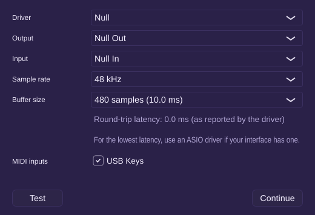
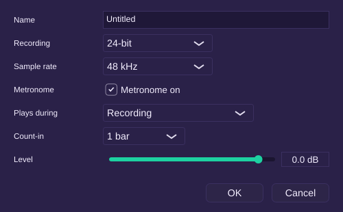
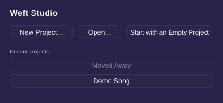

# Milestone 9 report: save/load UX

## What works

- **File menu:** New Project (Ctrl+N), Open (Ctrl+O), Open Recent, Save (Ctrl+S), Save As (Ctrl+Shift+S), Bounce, Project Settings, and Audio & MIDI Settings.
- **New Project** asks for a name and a sample rate (44.1, 48, 88.2 or 96 kHz) and creates `<Documents>/Weft Studio/<name>.weft`. A name that's taken becomes "<name> 2". The empty "Untitled" project Weft starts with disappears if you replace it or quit without touching it.
- **Open** takes a project folder or its `project.automerge`, and so does double-clicking that file. On open:
  - **Crash recovery:** if the project has changes from a crash, Weft asks "Recover unsaved changes from <time>?" Recover applies them; Discard keeps the saved state and archives the log.
  - **Missing plug-ins** are listed in one message. Their slots keep their state and pass audio through.
  - **Missing media:** a dialog says how many audio files are missing, with Locate… and Continue. Locate… searches a folder and its subfolders for files with matching content, whatever they're called, and copies them into `Media/`. Regions without their media show as missing until then.
  - This user's playhead, scroll and zoom come back as they were.
- **Unsaved changes:** New, Open and Quit ask "Save changes to "<name>"?" with Save, Don't Save and Cancel. Don't Save drops the changes for good, so they aren't offered as recovered next time. Quitting no longer saves silently.
- **The title** shows the project name with `*` while there are unsaved changes.
- **Save As** asks for a name and folder, with "Copy media into the new project" on by default. With it off, the new project uses the audio files where they are. The project takes the new name, its undo history carries on, and the original folder is left as it was.
- **Open Recent** lists the last ten projects, newest first. One that's been moved or deleted reads "<name> (not found)", and clicking it removes it from the list.
- **Project Settings:** the project name, the bit depth for new recordings (16, 24 or 32-bit float), the sample rate (only while the project has no audio), and the metronome defaults (on or off, recording/playback/both, count-in, level). Each change is one undo step.
- **First launch** shows Audio Setup before the main window:
  - Driver, output and input device, sample rate and buffer size. The defaults are WASAPI shared, the system devices, the device's current rate, and the buffer nearest 10 ms.
  - The round-trip latency the driver reports.
  - **Test** plays a 1 kHz tone at −18 dBFS for one second on outputs 1 and 2.
  - **Continue** saves the choices and opens the Welcome screen, with New Project, Open and the recent projects. Later launches skip Audio Setup and show the Welcome screen.
- **Audio & MIDI Settings** reopen the same dialog with OK and Cancel. It lists the connected MIDI inputs, each with an on/off switch (F-UI-8). MIDI devices now play instrument tracks the same way the computer keyboard does, and devices plugged in later appear without a restart.
- **No-audio mode:** when no output device can be opened, the main window still opens, with a banner and an Audio Setup… button. The transport plays silently in step with the system clock, and Record says that recording needs an audio device.

 

## Acceptance tests

Every [U], [E] and [UI] test passes in the Linux container: 227 ctest entries, with the [UI] tests in the one `ui-tests` entry. One entry was skipped because it needs a real audio device.

| Test | Level | Where |
|---|---|---|
| AT-PRJ-1 new project contents (now also through the New Project dialog) | U, UI | `tests/unit/ProjectTests.cpp`, `tests/ui/ProjectUiTests.cpp` |
| AT-PRJ-3 save, close, reopen: equal document, bit-identical 4-bar bounce | E | `tests/engine/ProjectFileTests.cpp` |
| AT-PRJ-5 `*` after an edit, gone after Ctrl+S | UI | `ProjectUiTests.cpp` |
| AT-PRJ-6 Save As with Copy media; original unchanged; opens with nothing missing | E | `ProjectFileTests.cpp` |
| AT-PRJ-7 Save As without copying references the original files | E | `ProjectFileTests.cpp` |
| AT-PRJ-8 missing file opens flagged; Locate… finds it by content under another name | E | `ProjectFileTests.cpp` |
| AT-PRJ-10 Open Recent: 10 newest first; a deleted one is unavailable and removed when clicked | U, UI | `ProjectTests.cpp`, `ProjectUiTests.cpp` |
| AT-PRJ-13 name and record bit depth; the next recording is 16-bit; sample rate locks once there's audio | U, UI | `ProjectTests.cpp`, `ProjectUiTests.cpp` |
| AT-UI-6 a disabled MIDI input stops reaching tracks; enabling restores it (the hot-plug part needs hardware) | E | `ProjectFileTests.cpp` |
| AT-UI-8 first launch shows Audio Setup; Test is 1 kHz at −18 dBFS for 1 s on the null device; Continue saves; second launch skips; no device gives No-audio mode with a banner | UI | `ProjectUiTests.cpp` |

AT-PRJ-2, 4, 9, 11 and 12 passed already in M1 and still pass. The UI tests also cover the Save / Don't Save / Cancel question, Recover and Discard on open, the missing plug-ins message, the Missing Media dialog and Save As.

## Stubbed or not yet done

- File › Exit isn't in the menu yet; closing the window quits, with the unsaved-changes question.
- Save Version (Ctrl+Alt+S) and anything shared, such as fetching missing media from the relay, come with collaboration (M10 to M12).
- The other Preferences tabs (General, Recording, Collaboration, Plugins) aren't built. Audio and MIDI are the Audio Setup dialog; plug-ins have the Plugin Manager.
- Templates, consolidate and the single-file archive are v2 (F-PRJ-2, 8, 12, 13).

## Known issues

- Linux CI has no sound card or MIDI devices, so the JUCE device lists, the latency readout on real drivers, ASIO and MIDI hot-plug have only been compiled there. They run on the Windows CI build but need hands-on checks with real hardware (the [HW] set).
- MIDI input uses channel messages only; MIDI clock and SysEx are ignored.
- Switching Audio Setup to bigger buffers exposed an engine bug: the engine kept buffers sized for the old block. It's fixed (D-ARCH-36), with the AT-UI-8 test running the new device at 480-sample blocks.

## Decisions made in this milestone

D-W0-3, D-W0-4 and D-W10-5 to D-W10-10 (`docs/spec/02-workflows.md`), D-ARCH-34 to D-ARCH-37 (`docs/ARCHITECTURE.md`).
